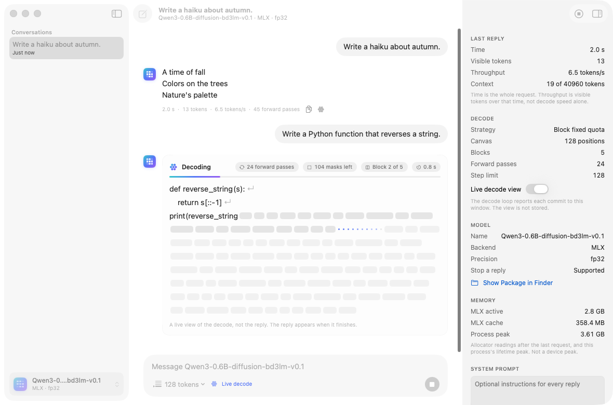
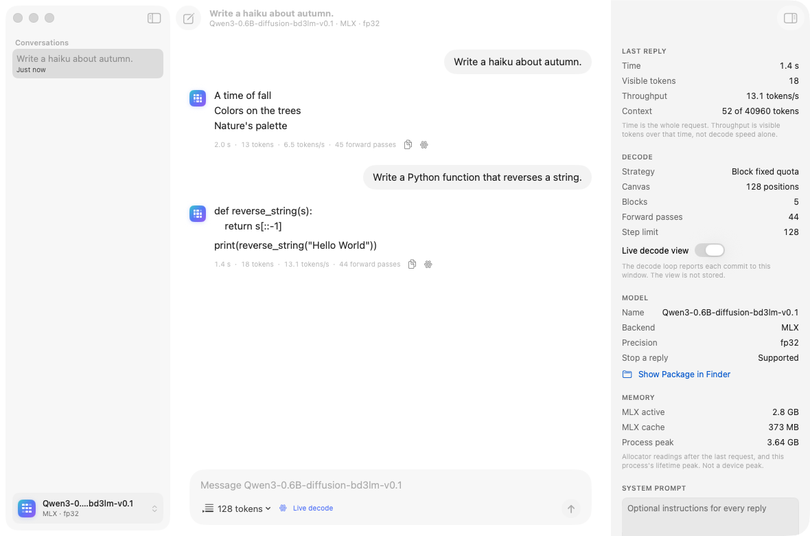

<div align="center">


<h1>DiffusorRT</h1>
<h3>Watch language emerge.</h3>

<p>Diffusion language models on local hardware.<br>
A Python runtime for your applications. A visual workspace for exploring the decode.</p>

<p>
<a href="https://github.com/jimmy-yilong-li/DiffusorRT/releases/tag/v0.2.5"></a>
<a href="./mac/README.md"></a>
<a href="#desktop-preview"></a>
<a href="./LICENSE"></a>
</p>

<p>
<a href="#desktop-preview"><strong>See the app</strong></a> ·
<a href="#install"><strong>Get started</strong></a> ·
<a href="#python-api">Python API</a> ·
<a href="#news">News</a> ·
<a href="./mac/README.md">Mac</a> ·
<a href="./windows/README.md">Windows / CUDA</a> ·
<a href="#citation">Cite</a>
</p>

</div>

<p align="center">
<a href="./mac/README.md"></a>
<br><sub>Real Mac app screenshot · live masked canvas · Qwen3-BD3LM 0.6B on Apple Silicon.<br>
The desktop shown here is the upcoming 0.2.6 preview. Downloadable SDK: <a href="https://github.com/jimmy-yilong-li/DiffusorRT/releases/tag/v0.2.5">0.2.5</a>.</sub>
</p>

DiffusorRT brings **diffusion decoding, local conversations and model management**
into one library. Start with a small model, build with Python, or explore how a
reply takes shape in the desktop preview. Inference runs on your machine;
the project focuses on edge devices and single-request use.

<table>
<tr>
<td width="33%"><h3>◈ See the diffusion</h3>
The desktop preview exposes the masked canvas, block progress and decode replay—not just the final reply.</td>
<td width="33%"><h3>⌘ Keep it local</h3>
Prepare a model once, reuse it offline and return to saved conversations. Context management belongs to the runtime.</td>
<td width="33%"><h3>↗ Build on one SDK</h3>
Python, CLI and a local HTTP service share model loading and execution. Bring your own application or memory integration.</td>
</tr>
</table>

## News

- **2026-11-12 · A first look at the desktop.** The **Mac 0.2.6 preview** adds
  a native chat window, live masked-sequence visualization, replay, cooperative
  Stop and a resource inspector. [See the screenshots →](./mac/README.md#desktop-preview)
  The app and SDK 0.2.6 are not downloadable yet.
- **2026-11-12 · CUDA PC progress.** A Windows/RTX 4070 chat interface is in
  development, with a masked-text view and GPU resource panel.
  [Windows & WSL →](./windows/README.md) Linux CUDA server delivery is separate;
  no CUDA binaries are included in the current public download.
- **2026-11-02 · SDK 0.2.5 is available.** Install the library from GitHub
  Releases. This maintenance preview improves deployment error handling.
  [Download →](https://github.com/jimmy-yilong-li/DiffusorRT/releases/tag/v0.2.5)
- **2026-10-21 · More ways to use the SDK.** Structured chat replies, model
  capability queries, file/stdin prompts, multiline chat and shared storage
  settings arrived in 0.2.4.
  [Release history →](https://github.com/jimmy-yilong-li/DiffusorRT/releases)

## Desktop preview

**From masked positions to a finished reply.** The Mac app shows the decode as
it happens, then lets you replay the retained steps. Conversation history stays
separate from intermediate frames.

<p align="center">

<br><sub>Completed replies · local conversation history · timing, context and memory inspector.</sub>
</p>

| In the Mac preview | What you can do |
|---|---|
| **Live canvas & replay** | Watch masked positions become text and revisit retained decode frames while the app is open. |
| **Native conversation workspace** | Reopen chats, send multiline prompts and adjust the next reply's output limit. |
| **Stop & keep your draft** | Stop at a decode boundary; messages that were not committed remain available to edit or resend. |
| **Resource inspector** | See elapsed time, visible tokens, forward passes, context use and named memory readings. |

The screenshots are from the real **macOS 14+ / Apple Silicon** app candidate,
not mockups or the Windows interface. Live frames are previews, not streamed
final-answer tokens. Desktop downloads and installation instructions will appear
when the app is released; until then, use the Python library and CLI below.

**[Explore the Mac preview →](./mac/README.md)** &nbsp; · &nbsp;
**[Follow Windows / CUDA PC →](./windows/README.md)**

## Install

**Available today: SDK 0.2.5 · Python 3.11 · Apple Silicon / macOS.**

No source build is needed. Use an existing Python 3.11 conda environment, or
create a virtual environment:

```bash
python3.11 -m venv .venv
source .venv/bin/activate
python -m pip install "diffusor-rt[compiler,mlx-local] @ https://github.com/jimmy-yilong-li/DiffusorRT/releases/download/v0.2.5/diffusor_rt-0.2.5-py3-none-any.whl"
```

Get your first reply:

```bash
diffusorrt run "dllm-hub/Qwen3-0.6B-diffusion-bd3lm-v0.1" --prompt "Hello!" --max-tokens 32
```

The first run downloads about **1.5 GB** of weights and builds a roughly
**3 GB** execution package. Allow about **8.9 GiB** of free disk space during
preparation; later runs reuse the package. The small default model needs no
private backend wheel.

The package is distributed through **GitHub Releases, not PyPI**.
Package name: `diffusor-rt`. Python import: `diffusor_rt`.

<details>
<summary>Verify, upgrade, or install a downloaded wheel</summary>

```bash
python -c "import diffusor_rt; print(diffusor_rt.__version__)"
diffusorrt --help

# If you downloaded the wheel into this directory:
python -m pip install "./diffusor_rt-0.2.5-py3-none-any.whl[compiler,mlx-local]"
```

Add `--upgrade` to the installation command when upgrading. Model-ID loading
rebuilds stale packages when needed; keep model downloads and conversation
history. If an older conversation reports an execution-identity mismatch, use
a new `--session` name to retain the old history rather than deleting it.
Explicit package paths remain pinned to their contents.

SDK 0.2.5 wheel SHA-256:
`17cd8a9eb3aed3f21e71381c351fe6b51a456f1896f8def66e1f43517141c52e`.

The desktop shown above is not part of 0.2.5. Do not use a 0.2.6 download URL
until that release exists.

</details>

## Python API

```python
from diffusor_rt import Engine

with Engine.from_pretrained(
    "dllm-hub/Qwen3-0.6B-diffusion-bd3lm-v0.1",
    backend="mlx_local",
) as engine:
    reply = engine.generate("Hello!", max_tokens=32)
    print(reply.text)
    print(reply.elapsed_seconds)
```

Use `engine.chat_result(message)` for a structured chat reply with text, finish
reason, elapsed time and `.to_dict()`; `engine.chat(message)` returns a string.
Pass `on_stage=print` to `Engine.from_pretrained()` for preparation progress.
The context manager closes the engine and releases its resources.

**[Download the ready-to-run Python example →](./examples/quickstart.py)**

## Command line

```bash
MODEL="dllm-hub/Qwen3-0.6B-diffusion-bd3lm-v0.1"

# A conversation you can reopen later.
diffusorrt chat "$MODEL" --session local-demo

# Inspect capabilities without loading weights.
diffusorrt models "$MODEL" --json

# Prepare explicitly, or let run/chat prepare it.
diffusorrt pull "$MODEL"
diffusorrt doctor "$MODEL"

# Use a UTF-8 file as your prompt.
diffusorrt run "$MODEL" --prompt-file ./prompt.txt
```

Interactive chat supports `/help`, `/new` and `/multiline` (`/send` to submit).
Add `--offline` after preparing a model to forbid network access.
`--cache-root` and `--data-root` select model storage and local state.
Before preparation, `doctor` reports not ready; that is not an installation failure.

History is stored in **plain, unencrypted local SQLite**. Context management
keeps requests within the model's token budget; summaries are opt-in and cost
additional model work. Applications can supply a `MemoryProvider`; there is no
automatic long-term memory collection.

<details>
<summary><strong>Optional: terminal model manager and local HTTP service</strong></summary>

```bash
python -m pip install "diffusor-rt[compiler,mlx-local,serve,tui] @ https://github.com/jimmy-yilong-li/DiffusorRT/releases/download/v0.2.5/diffusor_rt-0.2.5-py3-none-any.whl"

# Model packages and saved run profiles:
diffusorrt models

# Local service:
diffusorrt serve "dllm-hub/Qwen3-0.6B-diffusion-bd3lm-v0.1" --host 127.0.0.1 --port 8000
```

From another terminal:

```bash
curl http://127.0.0.1:8000/health
curl http://127.0.0.1:8000/v1/generate \
  -H 'Content-Type: application/json' \
  -d '{"prompt":"Hello!","max_tokens":32}'
```

Press Ctrl-C to close the service. Keep it on localhost: this preview is not an
authenticated Internet-facing service and does not provide OpenAI-compatible
streaming or continuous batching.

</details>

## Models and platforms

| Model | Public SDK on Apple Silicon |
|---|---|
| **Qwen3-BD3LM 0.6B** | Recommended first run. MLX fp32, block diffusion, ordinary prompt lengths, no K/V cache. |
| **Qwen3-MDLM 0.6B** | MLX fp32, bidirectional fixed-quota decoding. Very short outputs and infill/edit quality remain limited. |
| **LLaDA-8B-Instruct** | MLX fp32 baseline; much larger, with an approximately 32 GB execution package. A trailing end-of-turn marker is a known limitation. |
| **Dream-7B** | Its exact-D2F profile requires a separate private native runtime; not included in this download. |

Model IDs and Mac details are in the **[Mac guide](./mac/README.md#models)**.
Small checkpoints can make factual or arithmetic mistakes. BD3 does not
support infill/edit; a positive-budget request with no visible output raises
`EmptyGenerationError`. Output limits can truncate replies.

| Platform | Availability |
|---|---|
| **Mac / Apple Silicon** | SDK 0.2.5 downloadable. Native app and 0.2.6 SDK preview shown above, not yet released. |
| **Windows / WSL CUDA PC** | [In development](./windows/README.md); no complete public CUDA artifact set. |
| **Linux CUDA server** | Separate backend and hardware qualification; no CUDA binaries in the public SDK release. |

The SDK's `py3-none-any` tag describes its Python payload, not support for every
GPU. Platform execution dependencies remain separate. The retained Mac
real-model baseline is Apple M4 Max / 64 GB / MLX fp32; screenshots are not
benchmarks or certification of other devices.

## Research and reuse

DiffusorRT explores practical diffusion-language-model inference on edge
hardware: shared decoding policies, explicit resource ownership and observable
execution. The current public distribution is the installable SDK plus selected
examples and API excerpts—not the complete development tree. **Install the
wheel to run it**; cloning this repository alone is not a source installation.

<details>
<summary>API references and validation scope</summary>

- [Python entry point](./python/src/diffusor_rt/__init__.py)
- [Engine API excerpt](./python/src/edllm/engine.py)
- [Quickstart example](./examples/quickstart.py)

These excerpts are reading aids, not a second implementation.
The 0.2.5 patch was checked with fresh installation, CLI/API deployment errors
and a tiny-package upgrade/conversation path. It did not rerun the full suite
or every real model. The GUI screenshots show a later candidate, not additional
validation of 0.2.5. No general accuracy, speedup or cross-platform parity claim
is made here.

</details>

## Citation

If you use DiffusorRT in research, cite the version you used through
**Cite this repository** or [CITATION.cff](./CITATION.cff).

## License

The public Python SDK, Reference Compiler, NumPy reference runtime and public
MLX components are [Apache-2.0](./LICENSE). Optimized native backends and the
upcoming native app have separate distribution terms; model assets retain
their upstream licenses. See [Copyright and Licensing](./COPYRIGHT_AND_LICENSING.md)
and [Security](./SECURITY.md).
