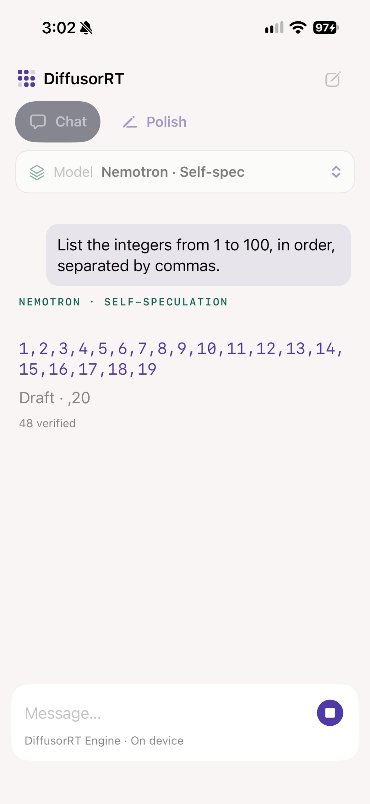
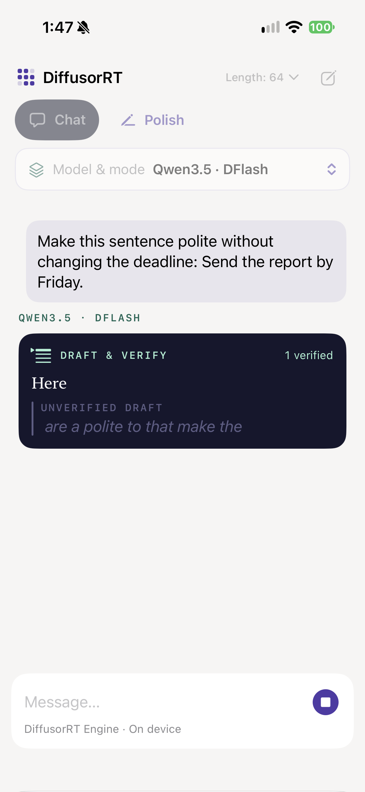
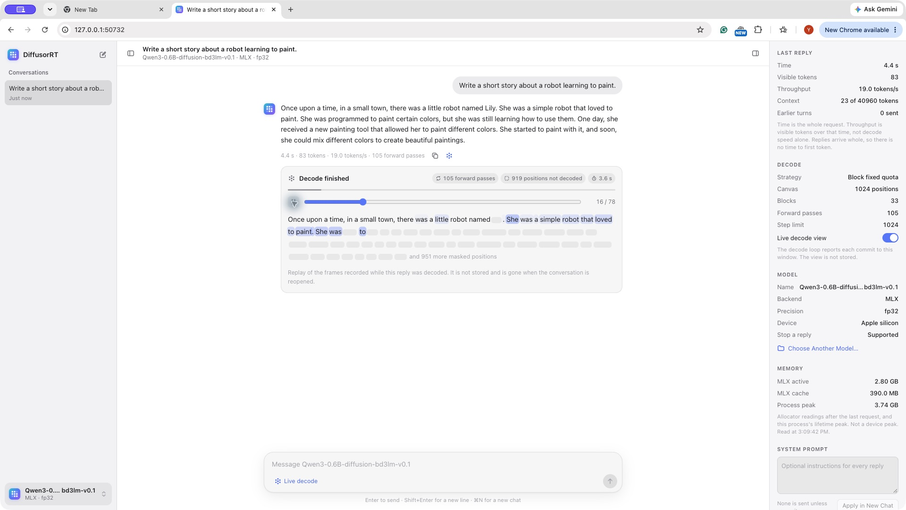
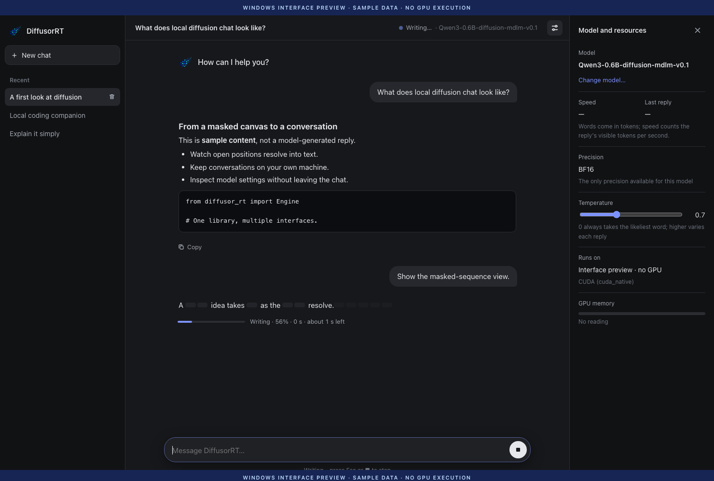

<div align="center">


<h1>DiffusorRT</h1>
<h3>Watch language take shape.</h3>
<p>Diffusion language models that run where you write.<br>
On Mac, watch a reply take shape. On iPhone, let the words change inside your draft.</p>

<p>
<a href="https://github.com/jimmy-yilong-li/DiffusorRT/releases/tag/v0.2.6"></a>
<a href="./mac/README.md"></a>
<a href="#iphone-app"></a>
<a href="./windows/README.md"></a>
<a href="./LICENSE"></a>
</p>

<p>
<a href="#downloads"><strong>Downloads</strong></a> ·
<a href="#iphone-model-packs">Model packs</a> ·
<a href="#news"><strong>Milestone &amp; News</strong></a> ·
<a href="#mac-runtime">Mac runtime</a> ·
<a href="#mac-gui">Mac GUI</a> ·
<a href="#iphone-app">iPhone app</a> ·
<a href="./DFlash/">DFlash research</a> ·
<a href="#desktop-experience">Desktop gallery</a> ·
<a href="#install">Install</a> ·
<a href="#installation-experience">What to expect</a> ·
<a href="#install-from-source">Source</a> ·
<a href="#python-api">Python API</a> ·
<a href="#command-line">CLI</a> ·
<a href="./INDEX.md">User guide</a>
</p>

</div>

## News

> [!IMPORTANT]
> **◆ MILESTONE · November 21, 2026 — A new Mac runtime, a model picker in Mac chat, and DiffusorRT on iPhone.**
> The [Mac runtime](#mac-runtime) and [iPhone app](#iphone-app) share a native decoding core. The [Mac GUI](#mac-gui) now lets you get a model and choose how it writes each reply. **These are collaborator previews, not a public release.** The current [public SDK download is still 0.2.6](https://github.com/jimmy-yilong-li/DiffusorRT/releases/tag/v0.2.6).

**2026-11-21 · [DFlash on iPhone →](./DFlash/)** A 4-bit Qwen3.5-4B target and its diffusion drafter completed two replies **1.67× and 2.05× faster** than autoregressive decoding on iPhone 15 Pro. Our next research milestone is **Cross-Accelerator Inference**: draft on the Neural Engine and verify on the Metal GPU.

**2026-11-20 · AMD Radeon — release soon.** Nemotron-3B self-speculative decoding also ran end to end on the Radeon 8060S using ROCm. The ROCm and Windows CUDA providers are not public downloads.

| Date | Public releases |
|---|---|
| **2026-11-13** | **SDK source published.** The Apache-2.0 SDK includes the Mac and Windows chat interfaces and matches the 0.2.6 wheel. [Install from source](#install-from-source). |
| **2026-11-12** | **[SDK 0.2.6: local chat and visible diffusion](https://github.com/jimmy-yilong-li/DiffusorRT/releases/tag/v0.2.6).** Open the Mac chat window, stop a supported reply, or replay its masked-token canvas. [Mac guide](./mac/README.md) · [Windows interface preview](./windows/README.md). |
| **2026-11-02** | **[SDK 0.2.5](https://github.com/jimmy-yilong-li/DiffusorRT/releases/tag/v0.2.5).** Clearer deployment errors and upgrade checks. |

## Downloads

GitHub hosts the [software releases](https://github.com/jimmy-yilong-li/DiffusorRT/releases); our [Hugging Face repositories](https://huggingface.co/jimmylearnML) host the ready-to-load model packs. Download only the models you want.

| What you want | Where to get it |
|---|---|
| **Run local inference on Mac** | [Download the public SDK wheel (0.2.6)](https://github.com/jimmy-yilong-li/DiffusorRT/releases/download/v0.2.6/diffusor_rt-0.2.6-py3-none-any.whl) · [Checksums](https://github.com/jimmy-yilong-li/DiffusorRT/releases/download/v0.2.6/SHA256SUMS-sdk-0.2.6.txt). Follow the [Apple Silicon install steps](#install) for MLX. This is a portable Python wheel, not a compiled Metal or CUDA provider. |
| **Open the desktop GUI** | The [Mac chat window](./mac/README.md) ships in the SDK: install the GUI extra, then launch it with `diffusorrt gui`. The [Windows GUI](./windows/README.md) is a preview; there is no public CUDA bundle or standalone installer. |
| **Try the new native runtime or iPhone app** | [Mac runtime preview](#mac-runtime) · [iPhone app gallery](#iphone-app). The native runtime binaries and standalone apps are not public downloads yet. The iPhone model packs below **are public now**. |

### iPhone model packs

These are the **same pinned files the iPhone model picker downloads**, already prepared for DiffusorRT. No account or model conversion is needed. Start with 4-bit; choose FP16 if you want the unquantized 0.6B weights.

| Model | What it does | Download files |
|---|---|---|
| **Qwen3 MDLM · 0.6B** | Diffusion chat and in-place editing | [4-bit · 581 MB](https://huggingface.co/jimmylearnML/DiffusorRT-iPhone-Qwen3-MDLM-0.6B-Q4/tree/cf81b92b97162d9ae4a3bb5c6248030d24cfbbe5) · [FP16 · 1.21 GB](https://huggingface.co/jimmylearnML/DiffusorRT-iPhone-Qwen3-MDLM-0.6B/tree/a93203090ac497fe8392197c5c2d6b5790120a90) |
| **Qwen3 BD3LM · 0.6B** | Block diffusion chat | [4-bit · 581 MB](https://huggingface.co/jimmylearnML/DiffusorRT-iPhone-Qwen3-BD3LM-0.6B-Q4/tree/46b8da273e7effefd1f4c951077eb88ae0a5808a) · [FP16 · 1.21 GB](https://huggingface.co/jimmylearnML/DiffusorRT-iPhone-Qwen3-BD3LM-0.6B/tree/4176d8e2f120a886dfdc522f1db3feed762ed395) |
| **Nemotron-Labs-Diffusion · 3B** | One model for diffusion, self-speculation and autoregressive chat | [4-bit · 2.76 GB](https://huggingface.co/jimmylearnML/DiffusorRT-iPhone-Nemotron-Labs-Diffusion-3B-Q4/tree/0343d805c686cc0fb714bc64cc0e58d5ed2737df) |
| **Qwen3.5 · 4B target** | Run autoregressively on its own, or verify DFlash proposals | [4-bit · 2.40 GB](https://huggingface.co/jimmylearnML/DiffusorRT-iPhone-Qwen3.5-4B-Q4/tree/30e5b29b98ece19fe5490e00e7fe94b8113a6358) |
| **DFlash drafter for Qwen3.5** | Optional Metal drafter. Install the Qwen3.5 target above first. | [4-bit · 303 MB](https://huggingface.co/jimmylearnML/DiffusorRT-iPhone-Qwen3.5-4B-DFlash-Q4/tree/062263e612c4e322656d51be45e912f9e611b441) |

In the iPhone preview, choose **Chat → Model & mode → Download**. To download a complete pack on your computer, use the Hugging Face CLI. For example:

```bash
hf download jimmylearnML/DiffusorRT-iPhone-Qwen3-MDLM-0.6B-Q4 \
  --revision cf81b92b97162d9ae4a3bb5c6248030d24cfbbe5 --local-dir ./mdlm-0.6b-q4
```

Keep the pack directory intact: the weights alone are not an installation. For the public Mac SDK, follow the [Mac model setup](#install) instead.

## Apple preview

### Mac runtime

**One Nemotron-3B checkpoint, three decoding modes.** The C++ engine runs diffusion, autoregressive decoding and linear self-speculation on Metal. In the last mode, Nemotron drafts several tokens, then verifies them itself; it does not load a second model. Mac and iPhone share that decoding code and Metal kernels, but tune the kernels separately.

The Mac engine can also open **prepacked 4-bit weights** without quantizing them at launch. On an M4 Max, the same Qwen3.5-4B target opened in **0.35 s** prepacked versus **1.28 s** when quantized from FP32 at load time. That measures model opening, not time to the first reply.

### Mac GUI

**Get a Model → Open → Chat.** In the preview window, see the download size, disk footprint and license before choosing a model. Stop a download and resume it later; if a prepared model is out of date, choose **Update** from the catalog.

In the **WebKit chat window**, open Nemotron-3B with Metal and pick **Diffusion**, **Self-Speculation** or **Autoregressive** for the next message without leaving the conversation. The live canvas shows which positions are still masked. Qwen3.5 DFlash is **not** a mode in this Mac window; the [desktop screenshots below](#desktop-experience) show the public 0.2.6 interface, not this preview.

### iPhone app

**Watch the draft before it becomes the reply.** In these iPhone 15 Pro captures, the lighter text is a proposal. Only verified tokens join the answer.

<table>
<tr><th width="50%">Self-speculative decoding · Nemotron-3B</th><th width="50%">DFlash · Qwen3.5-4B</th></tr>
<tr>
<td align="center"><a href="./docs/product/assets/iphone15pro-nemotron-self-speculation.png"></a></td>
<td align="center"><a href="./DFlash/assets/iphone15pro-dflash-live.png"></a></td>
</tr>
<tr>
<td><strong>One model.</strong> Nemotron drafts several tokens, then checks them itself.</td>
<td><strong>Two models.</strong> A diffusion drafter proposes a block; Qwen3.5 verifies it. Both run on Metal in this capture. <a href="./DFlash/">More on DFlash →</a></td>
</tr>
</table>

**Chat and Polish · 1.1 beta 1, build 2.** The app on iPhone 15 Pro ships without weights. In **Chat → Model & mode**, download the **581 MB, 4-bit Qwen3 MDLM** once; chat and writing then work offline. A diffusion reply fills in across the canvas. Press **Stop** and the already confirmed, visible text stays in the chat.

In **Polish** on iOS 18+, select a phrase inside an email draft. MDLM reads the words on both sides and fills only that gap. Accept the edit, undo it or keep your original. This is inside the app, not a system Mail extension. An illustration:

> Hi Maya, **`▧ ▧ ▧ ▧`**. Could we meet on Friday?<br>
> Hi Maya, **I won’t be able to make it today**. Could we meet on Friday?

For chat, Nemotron-3B offers the same three decoding modes on the phone. Qwen3.5-4B runs autoregressively on its own; add the optional **303 MB DFlash drafter** to try paired draft-and-verify decoding. The iPhone app is not on TestFlight or the App Store.

### Measured on hardware

| On hardware · time to finish | Draft + verify | Autoregressive |
|:---|---:|---:|
| **M4 Max** · Nemotron-3B BF16 · 1,024 tokens | **14.63 s** | 19.22 s |
| **iPhone 15 Pro** · Qwen3.5-4B 4-bit · deadline prompt | **2.73 s** | 4.55 s |
| **iPhone 15 Pro** · same model · train-speed prompt | **2.26 s** | 4.64 s |

<sub>Mac: linear self-speculation, median of two runs per mode; the continuations differed. iPhone: DFlash with a separate drafter, one warm run per mode and prompt, 64-token limit, identical tokens within each pair. DFlash finished both replies sooner, but first readable text was later on one prompt and tied on the other. Compare within rows, not across devices.</sub>

**Try the public SDK today →** [First reply on Mac](#mac--from-install-to-first-reply) · [Windows base SDK](#windows--install-the-base-sdk) · [All public downloads](https://github.com/jimmy-yilong-li/DiffusorRT/releases)

## Desktop experience

<table>
<tr>
<td width="50%" valign="top">
<h3>⌘ Mac · Apple Silicon</h3>
<a href="./mac/README.md"></a>
<p><strong>Install today.</strong> Local chat, saved conversations, cooperative Stop and recorded decode replay.</p>
<p><sub>Actual installed SDK 0.2.6 on Mac. The image shows a recorded decode replay, not a live performance benchmark.</sub></p>
<p><a href="./mac/README.md"><strong>Mac setup &amp; screenshots →</strong></a></p>
</td>
<td width="50%" valign="top">
<h3>▦ Windows · NVIDIA CUDA</h3>
<a href="./windows/README.md"></a>
<p><strong>Explore the interface.</strong> Masked-text rendering, model selection, conversation history and sampling controls.</p>
<p><sub>UI preview rendered from the PC frontend with sample data on Mac. Not a Windows machine capture or a GPU run.</sub></p>
<p><a href="./windows/README.md"><strong>Windows / WSL setup &amp; availability →</strong></a></p>
</td>
</tr>
</table>

- **See the decode:** observe a masked canvas becoming text; keep provisional
  frames separate from the final answer.
- **Keep it local:** conversations live on your machine. CLI and GUI reopen
  the same history.
- **Build on the framework:** use Python, CLI, optional TUI or HTTP without
  maintaining a separate model-loading pipeline.
- **Choose the platform deliberately:** one Python SDK, platform-specific
  acceleration. [Do not mix SDK/native release sets](./docs/product/sdk-0.2.6-installation.md).

## Install

### Mac — from install to first reply

Use **Python 3.11 on Apple Silicon**. No Git clone or native compiler build is
needed to install the library.

**1. Create an environment and install.**

```bash
python3.11 -m venv .venv
source .venv/bin/activate
python -m pip install "diffusor-rt[compiler,mlx-local,gui] @ https://github.com/jimmy-yilong-li/DiffusorRT/releases/download/v0.2.6/diffusor_rt-0.2.6-py3-none-any.whl"
```

Already using a Python 3.11 conda environment? Run just the `pip install`
line inside it. The package is distributed through GitHub Releases, not PyPI.

**2. Ask a question.**

```bash
diffusorrt run "dllm-hub/Qwen3-0.6B-diffusion-bd3lm-v0.1" --prompt "What is 2+2?" --max-tokens 32
```

The first run downloads and prepares the model automatically. In the recorded
installed check, this prompt returned `2+2 equals 4.`. This example is a
functional check, not an accuracy benchmark.

**3. Open the chat window.**

```bash
diffusorrt gui "dllm-hub/Qwen3-0.6B-diffusion-bd3lm-v0.1"
```

The window opens the model prepared in step 2. On Mac, the `gui` extra supplies
the WebKit window dependencies. Use `--browser` to open the page in your browser.
The separate native Swift App bundle is not part of this release.

### Windows — install the base SDK

Use **Python 3.11** in PowerShell. Calling the environment's Python directly
avoids changing PowerShell's activation-script policy:

```powershell
py -3.11 -m venv .venv
.\.venv\Scripts\python.exe -m pip install "https://github.com/jimmy-yilong-li/DiffusorRT/releases/download/v0.2.6/diffusor_rt-0.2.6-py3-none-any.whl"
.\.venv\Scripts\python.exe -c "import diffusor_rt; print(diffusor_rt.__version__)"
.\.venv\Scripts\python.exe -m diffusor_rt --help
```

**Expected result: SDK version `0.2.6` and CLI help.** This installs the base
API and package tools, not accelerated model inference. The public Windows
CUDA wheel set is still pending; do not install Mac's `mlx-local` extra or
reuse a Linux provider. [Windows installation details](./windows/README.md#installation-experience).

WSL uses a separate Linux Python environment and Linux native libraries.
Windows DLLs cannot be used in WSL. Linux/A100 has its own acceptance and
release track.

## Installation experience

For the recommended **BD3 0.6B Mac path**:

| Stage | What you see | What happens |
|---|---|---|
| Install the SDK | pip downloads the wheel and requested dependencies | The SDK wheel itself is about **0.91 MB**; extras are separate and considerably larger. No model is loaded. |
| First model run | Download/preparation messages before the reply | About **1.5 GB** of source weights are downloaded and a roughly **3 GB** execution package is prepared. |
| Prepare disk space | Keep about **8.9 GiB free** for model preparation | This includes temporary-build headroom, not just the final cache. Python dependencies need additional space. |
| Run again | The prepared package is reused | The first-run download/conversion is not repeated. A new process still needs to load the model into memory. |
| Open chat | The prepared model and saved conversations appear | Type normally, watch the decode, stop a supported request or revisit history. |

Download and preparation time depend on your connection and hardware. We do
not promise a universal installation time or model speed.

<details>
<summary><strong>Check the installation and handle common first-run surprises</strong></summary>

```bash
python -c "import diffusor_rt; print(diffusor_rt.__version__)"
python -m diffusor_rt --help
diffusorrt models "dllm-hub/Qwen3-0.6B-diffusion-bd3lm-v0.1" --json
```

These commands do not load model weights.

- **`doctor` says “not ready” before the first run:** prepare with `run` or
  `pull`. Exit status 1 here does not mean the library installation failed.
- **First launch takes longer:** it downloads and converts the model. Later
  launches reuse the prepared package.
- **No prepared model in the window:** run the step-2 command or `pull` first.
- **Missing an extra:** rerun the versioned wheel install command with the needed
  extras. The package is not currently installed by a plain PyPI-name command.
- **Offline use:** prepare online once, then add `--offline` to model commands.
  `doctor --offline` is metadata-only, not an inference-readiness check.
- **Low disk space:** source downloads and prepared packages both occupy space;
  the 8.9 GiB preparation allowance is not a RAM requirement.

</details>

<details>
<summary><strong>Upgrade without deleting your models or conversations</strong></summary>

Use the same release URL with `pip install --upgrade`. The checked
0.2.5-to-0.2.6 path preserved the prepared package and existing conversation.

Model-ID loading rebuilds stale execution packages when necessary. An explicit
package path remains pinned to that package. Keep your downloads and history;
do not erase them to resolve a version mismatch.

Older session identities can differ after model/configuration changes. Start a
new `--session` to preserve the old history, and delete a session only when you
intend to discard it. [Version pairing and checksums](./docs/product/sdk-0.2.6-installation.md).

</details>

## Python API

```python
from diffusor_rt import Engine

with Engine.from_pretrained(
    "dllm-hub/Qwen3-0.6B-diffusion-bd3lm-v0.1",
    backend="mlx_local",
) as engine:
    result = engine.generate("Hello!", max_tokens=32)
    print(result.text)
    print(result.elapsed_seconds)
```

Use `engine.chat_result(message)` for a structured conversation reply, or
`engine.chat(message)` for a string. The context manager closes the engine
and releases its resources. Model IDs resolve automatically; a prepared local
package path also works.

Try the standalone [quickstart script](./examples/quickstart.py) after installing
the wheel. [User index](./INDEX.md) · [Mac API examples](./mac/README.md#python-and-command-line).

## Install from source

Prefer to inspect or modify the SDK? The repository now contains the complete
Python package and both desktop-page implementations, matching SDK 0.2.6.
In your Python 3.11 environment on Apple Silicon:

```bash
git clone https://github.com/jimmy-yilong-li/DiffusorRT.git
cd DiffusorRT
python -m pip install -e "./python[compiler,mlx-local,gui]"
diffusorrt --help
```

On Windows, install the base SDK with `python -m pip install -e ./python`.
That does not supply a CUDA provider. The [source guide](./python/README.md)
maps the Mac and Windows UI code and explains what is included.
An explicit [SDK source archive](https://github.com/jimmy-yilong-li/DiffusorRT/releases/download/v0.2.6/diffusor-rt-sdk-0.2.6-source.tar.gz)
is also available; no Git clone is needed to inspect it.

## Command line

```bash
MODEL="dllm-hub/Qwen3-0.6B-diffusion-bd3lm-v0.1"

diffusorrt run "$MODEL" --prompt "Hello!"
diffusorrt chat "$MODEL" --session local-demo
diffusorrt run "$MODEL" --prompt-file ./prompt.txt
printf 'Hello!\n' | diffusorrt run "$MODEL" --prompt-file -
diffusorrt models "$MODEL" --json
```

In interactive chat, `/help` lists commands, `/new` opens a new conversation,
and `/multiline` starts a draft; finish with `/send` or discard with `/cancel`.
Use `--cache-root PATH` and `--data-root PATH` to choose local storage.

MLX replies run to model termination with a **1,024-token safety ceiling**.
Set `--max-tokens` for a smaller budget. GUI Stop takes effect at a supported
decode boundary, not in the middle of a GPU kernel.

### Model manager and local service

The optional TUI and HTTP adapter use the same library. Add their extras:

```bash
python -m pip install "diffusor-rt[compiler,mlx-local,gui,tui,serve] @ https://github.com/jimmy-yilong-li/DiffusorRT/releases/download/v0.2.6/diffusor_rt-0.2.6-py3-none-any.whl"
diffusorrt models
diffusorrt serve "$MODEL" --host 127.0.0.1 --port 8000
```

`diffusorrt models` without an ID opens the optional model manager in a terminal.
Run the HTTP service in its own terminal. The local server is not a hardened
public multi-user serving endpoint.

## Supported models and platforms

| Model | Public Mac path | Notes |
|---|---|---|
| **Qwen3-BD3LM 0.6B** | Recommended first run · MLX fp32 | Generate/chat; no private runtime needed. No infill/edit. |
| **Qwen3-MDLM 0.6B** | MLX fp32 baseline | Generate/chat; short-answer and infill quality remain limited. |
| **LLaDA-8B Instruct** | Existing MLX fp32 baseline | Much larger: about 32 GB prepared weights. A trailing `<\|eot_id\|>` may remain visible. |
| **Dream-7B** | Separate native runtime required | Its exact-D2F profile is not a standalone public-wheel path. |

The 0.2.6 installed walkthrough covered the two 0.6B models, CLI/API, persistent
chat, HTTP, upgrade and the Mac page/replay. It did not repeat a large-model run,
interactive TUI acceptance or Windows/CUDA hardware validation.

Small models can give wrong facts or arithmetic. A complete response is not an
accuracy guarantee. Mac sampling remains greedy; nonzero temperature is rejected.
The Windows CUDA sampling work has separate device evidence and distribution.

Conversations are stored in **plain, unencrypted local SQLite**. Summaries are
opt-in; applications can provide a `MemoryProvider`. Automatic long-term memory
collection is not enabled by default.

## Downloads and guides

- [Runtime, GUI and model pack downloads](#downloads)
- [SDK 0.2.6 release](https://github.com/jimmy-yilong-li/DiffusorRT/releases/tag/v0.2.6)
- [Mac installation and screenshots](./mac/README.md)
- [Windows / WSL installation and interface preview](./windows/README.md)
- [Matching SDK/native installations](./docs/product/sdk-0.2.6-installation.md)
- [User guide index](./INDEX.md) · [Report an issue](https://github.com/jimmy-yilong-li/DiffusorRT/issues)

The public download is `diffusor_rt-0.2.6-py3-none-any.whl`:

```text
SHA-256 86c9cee779bf65e127e3d5326caed806cf7bdada0d080ae41a5d540347116acb
```

The wheel and the published SDK source contain the Python modules and resources
needed to run the SDK, including both desktop-page interfaces. No native Mac
App bundle, CUDA provider or model weights are included. Earlier 0.2.0–0.2.4
downloads are retired; 0.2.5 remains the
previous SDK-only rollback reference.

## Citation and license

For research, cite the software version through [CITATION.cff](./CITATION.cff)
or GitHub's **Cite this repository** entry.

The SDK, Reference Compiler, NumPy reference and public MLX components are
[Apache-2.0](./LICENSE). Native backends and model weights retain their own
terms. The separate Swift App's distribution license remains unresolved.
[Licensing](./COPYRIGHT_AND_LICENSING.md) · [Security](./SECURITY.md).
