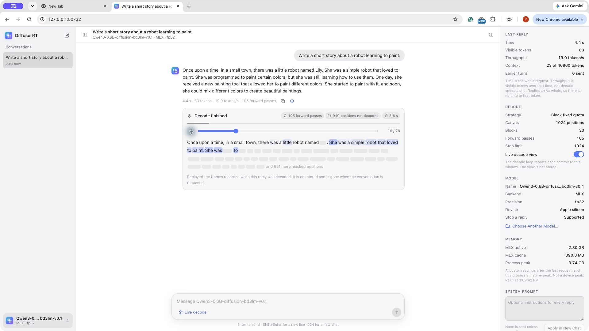
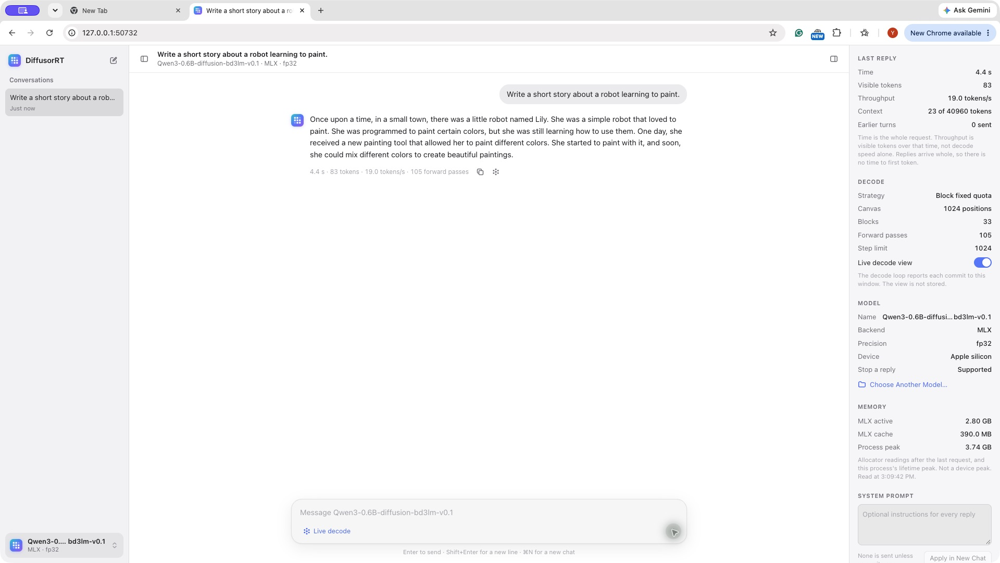

<div align="center">


<h1>DiffusorRT for Mac</h1>
<p><strong>Local conversations. Visible diffusion. Apple Silicon.</strong></p>

<p>


</p>

<p><a href="#install">Install</a> · <a href="#chat-window">Chat window</a> ·
<a href="#python-and-command-line">Python & CLI</a> · <a href="#models">Models</a> ·
<a href="#news">News</a> · <a href="../windows/README.md">Windows</a> ·
<a href="../README.md">All platforms</a></p>

</div>

DiffusorRT runs diffusion language models locally through one Python library.
Its chat window shows masked positions resolving into text, while the CLI and
Python API use the same model packages and conversations.

> **SDK 0.2.6 Developer Preview.** The download is a Python wheel, including
> the page-backed Mac chat window. The separate Swift App bundle is not
> published with this release; its distribution terms remain pending.
> [Matching versions and installation boundaries](../docs/product/sdk-0.2.6-installation.md).

## Install

Use **Python 3.11 on Apple Silicon**:

```bash
python3.11 -m venv .venv
source .venv/bin/activate
python -m pip install "diffusor-rt[compiler,mlx-local,serve,gui] @ https://github.com/jimmy-yilong-li/DiffusorRT/releases/download/v0.2.6/diffusor_rt-0.2.6-py3-none-any.whl"

diffusorrt run "dllm-hub/Qwen3-0.6B-diffusion-bd3lm-v0.1" --prompt "Hello!"
diffusorrt gui "dllm-hub/Qwen3-0.6B-diffusion-bd3lm-v0.1"
```

An existing Python 3.11 conda environment works too. The first model run
downloads about 1.5 GB and prepares a roughly 3 GB package; allow 8.9 GiB of
free space during preparation. Later runs reuse it. The window opens prepared
models; use `run` or `pull` first.

`compiler` supplies model preparation, `mlx-local` the Apple backend,
`serve` the local HTTP adapter, and `gui` the WebKit window dependencies.
This package is distributed through GitHub Releases, not PyPI.

## Chat window

<p align="center">

<br><sub>Actual installed wheel · Qwen3-BD3LM 0.6B · browser view of recorded decode frames.</sub>
</p>

- **Watch and replay.** The live view shows the current canvas. A completed
  reply can replay its recorded frames. Preview frames are not conversation
  messages and disappear when the conversation is reopened.
- **Stop.** Supported cache-free plans stop at a decode boundary. A GPU
  forward already running is not interrupted. A stopped turn is not saved.
- **Keep the draft.** Failed or stopped messages remain available to edit,
  resend or discard.
- **Continue locally.** Conversations persist across processes in plain,
  unencrypted SQLite. No cloud account is needed.
- **Inspect the work.** Details show elapsed request time, visible tokens,
  forward passes, context and MLX allocator readings. These are labeled
  observations, not device-wide peak memory or a fabricated first-token time.
- **Reply length.** MLX runs to model termination with a 1,024-token safety
  ceiling. Reaching that ceiling is reported as a cut-short reply.
- **System prompt.** Apply starts a new conversation; previous history stays
  saved. No system prompt is supplied unless you write one.

Return sends, Shift-Return inserts a line, and ⌘N starts a conversation.
`diffusorrt gui` opens the page in its own WebKit window;
`diffusorrt gui --browser` opens the default browser, and
`diffusorrt gui --no-browser` prints the local address. It binds to
`127.0.0.1` with a per-launch token.

<p align="center">

<br><sub>Completed reply from the rebuilt wheel. The displayed timing is one observation, not a speed claim.</sub>
</p>

The native Swift App is developed separately. Earlier native-app screenshots
are development previews, not proof of a downloadable App bundle.

## Python and command line

```python
from diffusor_rt import Engine

with Engine.from_pretrained(
    "dllm-hub/Qwen3-0.6B-diffusion-bd3lm-v0.1", backend="mlx_local"
) as engine:
    print(engine.generate("Hello!").text)
```

```bash
MODEL="dllm-hub/Qwen3-0.6B-diffusion-bd3lm-v0.1"
diffusorrt chat "$MODEL" --session local-demo
diffusorrt doctor "$MODEL"
diffusorrt models "$MODEL" --json
diffusorrt serve "$MODEL" --host 127.0.0.1 --port 8000
```

Before preparation, `doctor` returns status 1 and explains the next step.
`doctor --offline` is metadata-only: it does not open the package and does
not assert execution readiness, even when cached. Regular `doctor` checks
the prepared package. Use the main [README](../README.md) for stdin, TUI,
HTTP requests and API options.

## Models

| Model | Mac scope |
|---|---|
| Qwen3-BD3LM 0.6B | Recommended first run; fp32, no K/V cache, generate and chat. No infill/edit. |
| Qwen3-MDLM 0.6B | fp32 baseline, no K/V cache; generate and chat. Short-answer and infill quality remain limited. |
| LLaDA-8B | Existing fp32 baseline; about 32 GB prepared weights. Earlier candidate checked run/chat; this rebuild did not repeat that large-model run. A trailing `<\|eot_id\|>` can remain visible. |
| Dream-7B | Its exact-D2F profile needs a separate private native runtime, not supplied here. |

The two 0.6B models were exercised on the rebuilt installed wheel. This is
functional evidence, not an accuracy benchmark. Small models make factual
and arithmetic mistakes. Mac sampling remains greedy; a nonzero temperature
is explicitly rejected rather than ignored.

## Upgrade and verification

Use the same wheel URL with `pip install --upgrade`. Keep your model cache
and conversation data; a package rebuild is separate from deleting history.
Use a separate environment for CUDA rather than mixing native runtimes.

The new SDK was built from committed source and installed outside the checkout.
The bounded walkthrough covers the two small models, JSON/stdin, inspection,
cached preparation, cross-process chat and the actual page/replay above.
Earlier candidate evidence includes reference forward checks and LLaDA;
it is not relabeled as new evidence for this artifact. CUDA, the separate
Swift App and interactive TUI are not certified by this walkthrough.

Wheel SHA-256:

```text
86c9cee779bf65e127e3d5326caed806cf7bdada0d080ae41a5d540347116acb
```

## License

The Python SDK and public MLX components are [Apache-2.0](../LICENSE).
Model weights retain their upstream terms. The SDK license does not grant
distribution rights for the separate Swift App or private native backends.

## News

**2026-11-12 — SDK 0.2.6: chat and visible diffusion.** Open a local window,
inspect real decode frames, resume conversations and stop supported requests.
This page shows the rebuilt wheel, not a mockup. Mac, Windows CUDA PC and
Linux CUDA server remain separate release tracks.

Earlier updates: [project News](../README.md#news).
