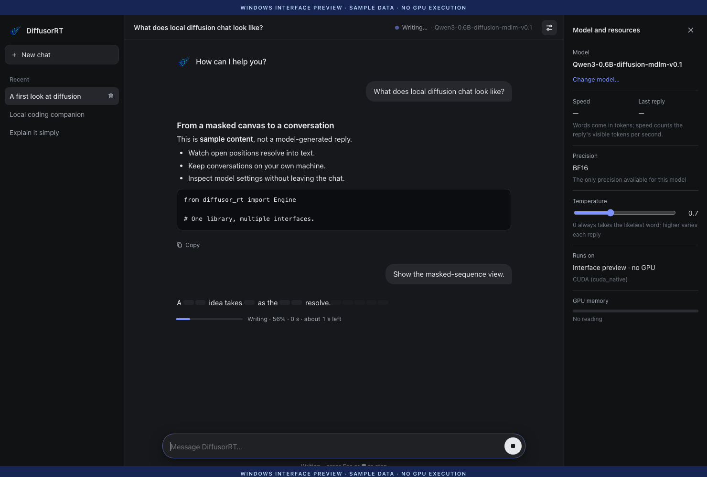

<div align="center">


<h1>DiffusorRT for Windows</h1>
<p><strong>Local diffusion chat on NVIDIA hardware.</strong></p>

<p>


</p>

<p><a href="#availability">Availability</a> ·
<a href="#installation-experience">Install the SDK</a> ·
<a href="#the-chat-interface">Chat interface</a> ·
<a href="#windows-and-wsl-are-different-installations">Windows / WSL</a> ·
<a href="#known-boundaries">Limits</a> ·
<a href="#news">News</a> ·
<a href="../mac/README.md">Mac</a> ·
<a href="../README.md">All platforms</a></p>

</div>

DiffusorRT's CUDA PC work connects the same Python APIs and local conversation
store to a Windows chat interface. The interface and the CUDA provider have
their own implementation and release checks; Mac acceptance does not cover them.

> [!NOTE]
> **Development preview — no public Windows CUDA artifact set yet.**
> The public SDK is [0.2.6](https://github.com/jimmy-yilong-li/DiffusorRT/releases/tag/v0.2.6).
> Its Mac chat window does not constitute a Windows CUDA release.
> [Matching installations: do not mix SDK/native release sets](../docs/product/sdk-0.2.6-installation.md).

## Availability

The Python SDK uses a `py3-none-any` wheel. That means its own payload is
portable Python, not that it contains a GPU runtime. Accelerated Windows use
also needs the matching Windows native provider, CUDA libraries, a supported
driver and an admitted model/precision combination.

Those native artifacts are not publicly downloadable from this project yet.
There is no complete public `pip install` command for Windows CUDA inference;
installing the SDK alone will not provide it. A Windows release will name the
exact wheels, supported GPU targets, dependencies and checksums here.

## Installation experience

You can install the **base Python SDK** today. In PowerShell with Python 3.11:

```powershell
py -3.11 -m venv .venv
.\.venv\Scripts\python.exe -m pip install "https://github.com/jimmy-yilong-li/DiffusorRT/releases/download/v0.2.6/diffusor_rt-0.2.6-py3-none-any.whl"
.\.venv\Scripts\python.exe -c "import diffusor_rt; print(diffusor_rt.__version__)"
.\.venv\Scripts\python.exe -m diffusor_rt --help
```

Calling the environment's Python directly avoids changing PowerShell's
activation-script policy. Expect `0.2.6` and the CLI help text. This checks
SDK installation only; it does not load a model or exercise CUDA.

The [SDK source guide](../python/README.md) also explains clone-based
installation. The Windows controller and page source are available in
[`python/src/edllm/gui`](../python/src/edllm/gui), with the frontend under
[`web/`](../python/src/edllm/gui/web). Publishing this UI code does not
publish the native CUDA provider it needs for inference.

| Step | Available now | What it does not supply |
|---|---|---|
| Install the SDK | Python API, package tools and the CLI | Model weights, CUDA runtime or a Windows native provider |
| Import / help | No model download or GPU allocation | Evidence that a CUDA model can run |
| Accelerated chat | Experimental implementation and interface preview below | A public matched native-wheel set; that release is pending |

Do not install `mlx-local` on Windows. Do not combine the SDK with an arbitrary
older private wheel, or use Linux binaries in Windows Python. Once CUDA
distribution is ready, this page will supply the exact SDK/native pair and
model preparation commands. Until then, use the [Mac guide](../mac/README.md)
for the complete public accelerated path.

## The chat interface

The development interface opens a local page in a standalone Microsoft Edge
window. It is not a native WinUI application or a packaged Windows installer.
Its loopback server runs on `127.0.0.1` with a per-launch access token.

<p align="center">

<br><sub>Windows interface preview · actual PC frontend rendered on Mac with sample events · not a Windows machine capture.</sub>
</p>

- **Watch the decode.** Decided text appears among masked positions while a
  reply forms. The intermediate canvas is a preview, not a committed answer.
- **Stop a reply.** Supported cache-free execution can stop at a decode
  boundary. This is not an interruption of a CUDA kernel already running.
- **Continue conversations.** The interface shares local history with the
  command line; history is plain, unencrypted SQLite.
- **Inspect resources.** The panel shows the selected model, backend,
  precision and GPU memory. Whole-device memory is not process-only usage.
- **Use prepared models.** The window selects prepared packages; it does not
  download or compile a checkpoint on its own.
- **Sample deliberately.** The reviewed CUDA fixed-quota path adds temperature
  and seed controls. This is a development capability, not a public native download.

The collaborator reports real Windows/RTX 4070 runs of the interface. These
are development results on one machine, not general Windows certification.
Windows-machine screenshots are pending delivery. The preview above renders
the actual PC HTML/CSS/JavaScript with sample conversation and decode events;
it does not use the Mac interface. Speed and GPU memory are deliberately
unreported. [Image provenance](./assets/README.md).

## Windows and WSL are different installations

| Environment | Native artifact | Window and support boundary |
|---|---|---|
| Native Windows | Windows wheel with DLLs for the selected Python/CPU ABI | Experimental Edge-hosted chat interface; requires native Windows acceptance. |
| WSL2 | Linux wheel with Linux shared libraries | Linux execution environment; native Windows DLLs do not apply, and Windows GUI results do not certify it. |
| Linux / A100 server | Linux wheel with an admitted SM80 target | Separate server release, with its own CLI/API/HTTP acceptance. |

SM89 and SM80 identify GPU architectures, not operating-system wheel tags.
One CUDA binary can cover both only when it contains compatible targets and
both targets have passed their advertised checks.

## Known boundaries

- The reviewed experimental PC path is Qwen3-MDLM 0.6B in BF16 on an RTX 4070.
  Do not infer support for every Qwen model, CUDA device or precision.
- INT8 did not pass the model's frozen correctness gate; it is not an
  advertised alternative for this path.
- CUDA budgets, dependency discovery, startup, Stop, shutdown and upgrade must
  pass the CUDA PC checks before public delivery. Mac results cannot replace them.
- A small model can make factual and arithmetic mistakes. A readable reply
  does not establish answer accuracy or parity with another backend.
- SDK, native-runtime and application versions need not match. A release must
  identify the compatible installed set rather than relying on version equality.

## License

The public Python SDK is [Apache-2.0](../LICENSE). Optimized native runtimes have
separate distribution terms; model weights retain their upstream licenses.
This development page grants no license to unpublished native binaries.

## News

**2026-11-12 — Installation walkthrough and interface preview.**
The page now shows the PC frontend with clearly labeled sample content and a
PowerShell base-SDK install path. This documentation update does not publish
a CUDA provider or claim a new hardware test.

**2026-11-12 — PC code integrated; native publication remains separate.**
Reviewed fixed-quota device execution, seeded sampling and failed-load retry
repairs are integrated. The SDK contains the PC interface code, but there is
no public CUDA wheel pair yet. The known long-context shared-memory ceiling
remains. Windows, WSL and A100 require their own installed qualification.

**2026-11-12 — Windows guide prepared; CUDA PC remains a separate release.**
The local chat interface, masked-text preview and resource panel are under
development. Native Windows and WSL use different artifacts. No Windows
installer, CUDA wheel or broader support claim is published with this update.
